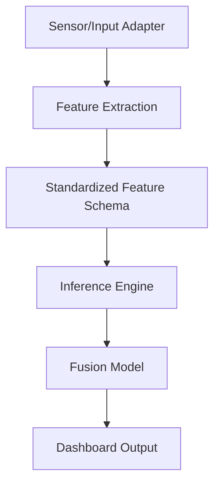

# Real-Time Inference Architecture

> [!WARNING]  
> The dataset is SIMULATED. The model performs experimental classification of deception-related behavioural and physiological patterns. The output is NOT proof that a person is lying. Stress, anxiety, fatigue, unfamiliarity, and other factors can produce similar signals.

## 1. System Architecture

The inference pipeline is designed to be fully decoupled from the training layer. It uses saved model artifacts from Phase 3, ensuring zero possibility of participant leakage or unintended model retraining during inference.

## 2. Model Artifacts

The final pipeline uses serialized `joblib` artifacts located in `models/`:
- `physiology_pipeline.joblib`
- `audio_pipeline.joblib`
- `vision_pipeline.joblib`
- `fusion_model.joblib`

## 3. Preprocessing

Each modality pipeline intrinsically handles its own preprocessing (`SimpleImputer` -> `StandardScaler` -> `LogisticRegression`). These were fitted on the full Phase 3 validated dataset. No imputation fitting or scaling logic happens dynamically on the incoming data.

## 4. Feature Schema

The exact schema mapping is stored in `models/model_features.json`. Adapters must supply a dictionary whose keys match these features.

## 5. Inference Flow

1. An adapter yields a trial feature dictionary.
2. `predict_trial()` extracts the subset of features for each modality.
3. Modalities run their respective pipelines.
4. The three resulting probabilities are passed through the late-fusion Logistic Regression model.
5. A structured result dictionary is generated containing probabilities, classification, and signal quality.

## 6. Missing Modality Handling

If a modality is missing (indicated by flags like `video_available: 0` or missing entirely from the dictionary while flags assert absence), the engine safely falls back to a neutral `0.5` probability. The fusion model intrinsically knows how to handle these neutral priors based on Phase 3 robustness training. The output dictionary explicitly defines `physiology_available`, `audio_available`, and `vision_available` booleans.

## 7. Signal Quality Handling

Signal quality (e.g., `GOOD`, `FAIR`, `POOR`) is preserved identically from the input layer and pushed through to the output dictionary.

## 8. Output Interpretation

Output probabilities range from `0` to `1`.
- `>= 0.5`: `DECEPTIVE CLASS`
- `< 0.5`: `TRUTH CLASS`

*Experimental classification ONLY.*

## 9. Simulation Replay

A CSV adapter (`simulation/sensor_adapter.py`) feeds the existing dataset rows one by one through the engine, simulating a live data stream.

## 10. Future Hardware Integration

The architecture natively supports swapping the `CSVSensorAdapter` for hardware interfaces (`input/camera_adapter.py`, `input/max30102_adapter.py`, etc.) as long as they yield a dictionary mapping to the schema.
